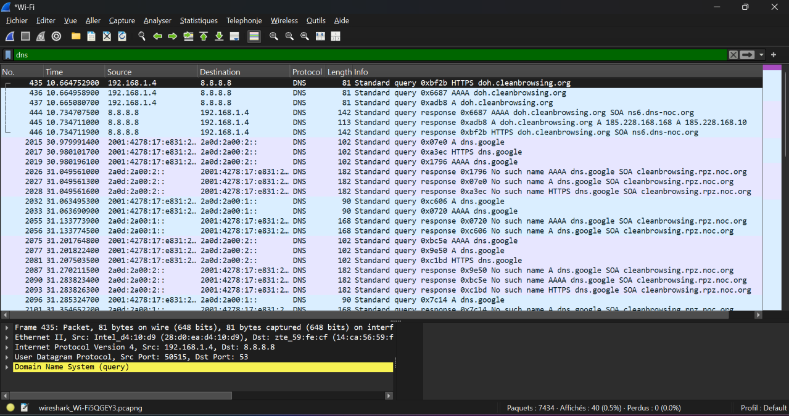
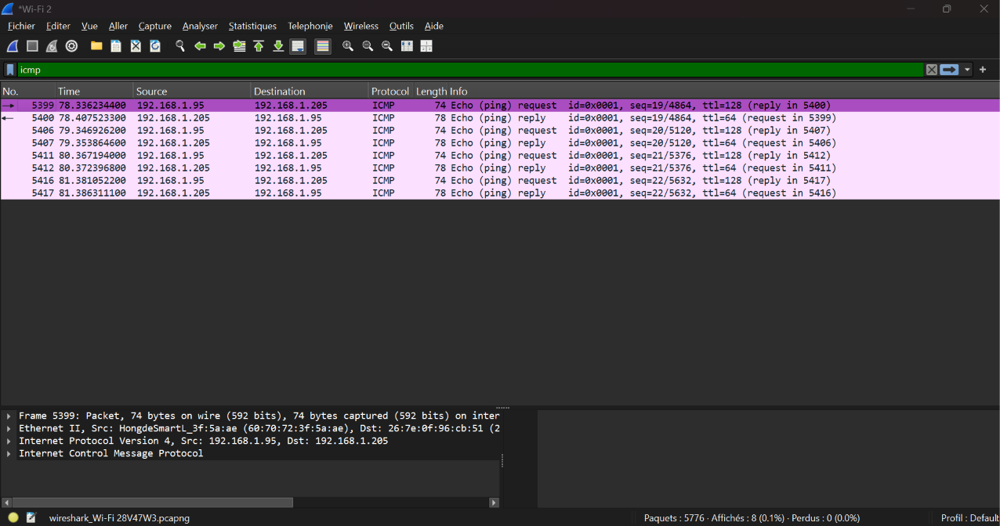
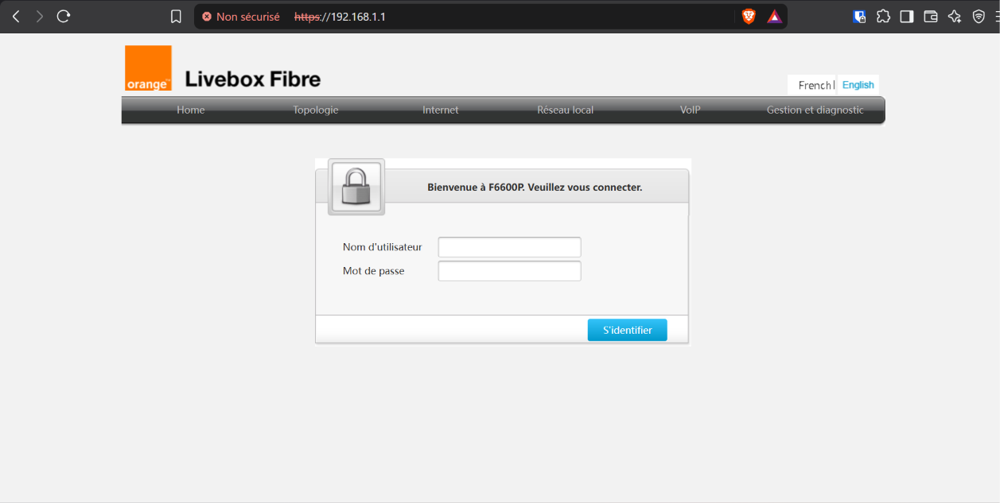

# TP Wireshark — Analyse du trafic réseau

## 🎯 Objectif

Ce TP présente mes premières manipulations avec **Wireshark**, un outil de capture et d’analyse des paquets réseau.

Les objectifs sont :
- Filtrer le trafic à partir d’une adresse IP.
- Observer les requêtes et réponses DNS.
- Identifier les échanges HTTP.
- Analyser les paquets ICMP.
- Générer du trafic HTTP et observer les paquets correspondants dans Wireshark.

## 🧰 Outils utilisés

- **Wireshark** : capture et analyse du trafic réseau.
- **Navigateur web** : génération de trafic HTTP en accédant à une page web.
- **Livebox** : interface locale utilisée lors de la manipulation HTTP.

## 1. Filtrer le trafic par adresse IP

**Filtre utilisé :**

```wireshark
ip.addr == 192.168.1.4
```

Ce filtre affiche les paquets dont l’adresse IP source ou destination est `192.168.1.4`.

La capture permet d’observer plusieurs protocoles, notamment TCP, UDP, STUN et TLSv1.2.


## 2. Analyser le trafic DNS

**Filtre utilisé :**

```wireshark
dns
```

Le DNS permet de rechercher les adresses IP associées aux noms de domaine.

La capture montre des requêtes et des réponses DNS concernant notamment `dns.google` et `doh.cleanbrowsing.org`.

Cette manipulation permet de reconnaître les requêtes DNS et d’observer les réponses fournies.



## 3. Analyser le trafic HTTP

**Filtre utilisé :**

```wireshark
http
```

Ce filtre permet d’afficher les paquets reconnus comme appartenant au protocole HTTP.

La capture montre notamment des requêtes `GET` et plusieurs réponses HTTP :

- `200 OK` : requête traitée avec succès.
- `302 Moved Temporarily` : redirection temporaire.
- `204 No Content` : requête réussie sans contenu à renvoyer.

Cette manipulation permet d’observer les échanges HTTP entre un client et un serveur.

Contrairement à HTTP, HTTPS chiffre les échanges applicatifs, ce qui limite la lecture directe de leur contenu dans Wireshark.


## 4. Observer les paquets ICMP

**Filtre utilisé :**

```wireshark
icmp
```

ICMP est notamment utilisé par la commande `ping` pour tester la connectivité entre deux hôtes.

La capture montre des messages `Echo (ping) request` et `Echo (ping) reply` entre les adresses IP `192.168.1.95` et `192.168.1.205`.

Une réponse ICMP indique que l’hôte distant a répondu à la requête au moment de la capture.



## 5. Générer et capturer du trafic HTTP

**Objectif :** générer du trafic HTTP en accédant à l’interface locale de la Livebox, puis observer les paquets dans Wireshark.

L’adresse utilisée dans le navigateur est :

```text
192.168.1.1
```

La capture du navigateur montre la page de connexion de la Livebox. Cette manipulation sert à produire du trafic à analyser avec Wireshark.

Pour observer les paquets, le filtre suivant a été utilisé :

```wireshark
http
```

La capture Wireshark permet d’examiner les requêtes HTTP et les réponses observées pendant la capture. Les captures disponibles ne permettent toutefois pas de confirmer que tous les paquets HTTP affichés correspondent exclusivement à l’accès à la Livebox.

**Capture du navigateur :**



**Capture du trafic HTTP dans Wireshark :**


## 🧠 Ce que j’ai appris

Au cours de ces manipulations, j’ai appris à :

- Utiliser des filtres d’affichage dans Wireshark.
- Identifier différents protocoles réseau.
- Observer les requêtes et les réponses DNS.
- Reconnaître des requêtes HTTP et leurs codes de réponse.
- Observer des échanges ICMP de type ping.
- Générer du trafic avec un navigateur et examiner les paquets capturés.

## ⚠️ Bonnes pratiques

- Capturer uniquement le trafic que l’on est autorisé à analyser.
- Vérifier les captures avant de les publier afin de protéger les informations privées.
- Ne pas publier d’identifiants, de mots de passe ou d’autres données sensibles.

---

*TP réalisé dans le cadre de mon apprentissage de l’analyse réseau avec Wireshark.*
